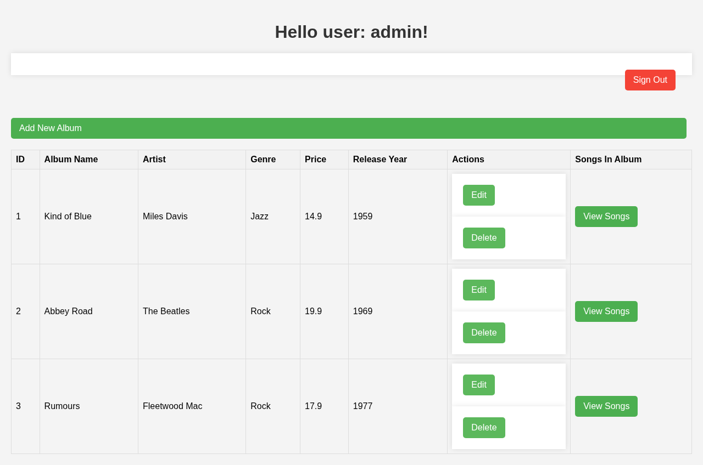
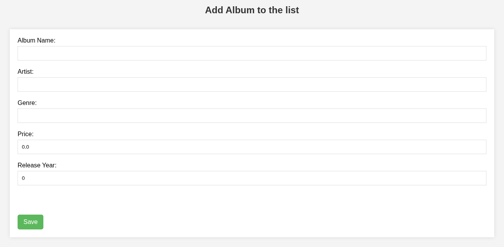
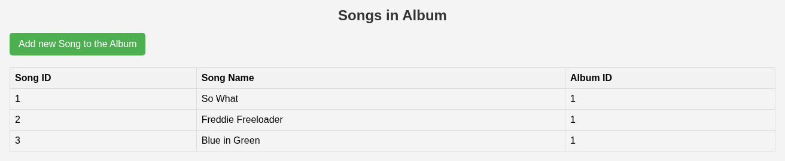

# Album Store

Spring Boot web app for browsing music albums and their songs. An admin logs in to add, edit and delete albums and add songs.

What it does:
- Album list (name, artist, genre, price, release year) and a song list per album. Both are open without login, for read-only browsing
- Form login with two roles, USER and ADMIN. Only ADMIN gets the add, edit and delete buttons and pages
- Validation on the album form: name, artist and genre required, release year 1900 or later
- REST API at `/api/albums`: GET (albums and songs), POST, PUT `/{id}`, DELETE `/{id}`. Spring Data REST also serves albums and songs under `/api`. The API uses HTTP Basic: any account can read, only ADMIN can write

Screenshots from a local run of the fixed code with the demo profile, 25 October 2026:



Album list, logged in as admin.



The add album form (ADMIN only).



Songs of one album.

Stack: Java 17, Spring Boot 3.1.5, Thymeleaf, Spring Data JPA, Spring Data REST, Spring Security (BCrypt), Bean Validation, MariaDB (H2 for the demo profile and the tests), Maven wrapper.

Run the demo, no database needed:

```
./mvnw spring-boot:run -Dspring-boot.run.profiles=demo      # macOS / Linux
mvnw.cmd spring-boot:run -Dspring-boot.run.profiles=demo    # Windows
```

It starts on in-memory H2 with 3 sample albums and the demo accounts. Open http://localhost:8080/album

Run with MariaDB:
1. Start MariaDB on localhost:3306 and run `albumscript.sql`. It creates the `albums` database and the tables. Hibernate (`ddl-auto=update`) updates the tables after that.
2. Set the database settings as environment variables:
   - `DB_PASSWORD`: your MariaDB password (empty if not set)
   - `DB_USERNAME`: defaults to `root`
   - `DB_URL`: defaults to `jdbc:mariadb://localhost:3306/albums`
3. Start the app, e.g. `DB_PASSWORD=yourpassword ./mvnw spring-boot:run` (on Windows set the variables first, then `mvnw.cmd spring-boot:run`), and open http://localhost:8080/album

Demo accounts: `user` / `user` (USER) and `admin` / `admin` (ADMIN). These are course demo credentials, don't use them on anything real. The demo profile creates them. For MariaDB the SQL script doesn't insert them, the code that does is commented out in `AlbumApplication.java`. Uncomment those 4 lines for the first run and comment them out again after, the usernames are unique so a second run would fail.

API example: `curl -u user:user http://localhost:8080/api/albums`

Test: `./mvnw verify` runs 17 tests on in-memory H2: the security rules, editing an album and adding songs. No MariaDB needed.

Fixed in the October 2026 review:
- Database username and password come from env vars, they were hard-coded in `application.properties`
- `/api/**` was open with CSRF off, and Spring Data REST served the user accounts with their password hashes at `/api/users`, where anyone could also add an ADMIN. Users aren't exported now, and the API needs login, ADMIN for writes
- `addalbum` / `editalbum` pages failed on Linux (template file names didn't match), editing an album deleted its songs, adding a song always failed, the custom login page wasn't used, and `albumscript.sql` made a sequence that stopped the app at startup
- The test was in the wrong package and failed, `mvnw` wasn't executable

Known gaps:
- `coverimage` holds the price. Renaming it needs a column change in the database, so it stays
- A missing album id gives a 500 error page, not a 404
- `GET /api/albums/{id}` answers 405. `AlbumRestController` takes over `/api/albums` from Spring Data REST and has no GET by id
- Spring Boot 3.1.x (and Spring Security 6.1 with it) has been out of open source support since May 2024. Bump to a supported 3.x before deploying this anywhere

Status: back-end course project, built 10 to 20 November 2023.
